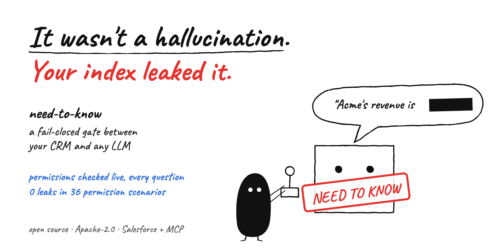
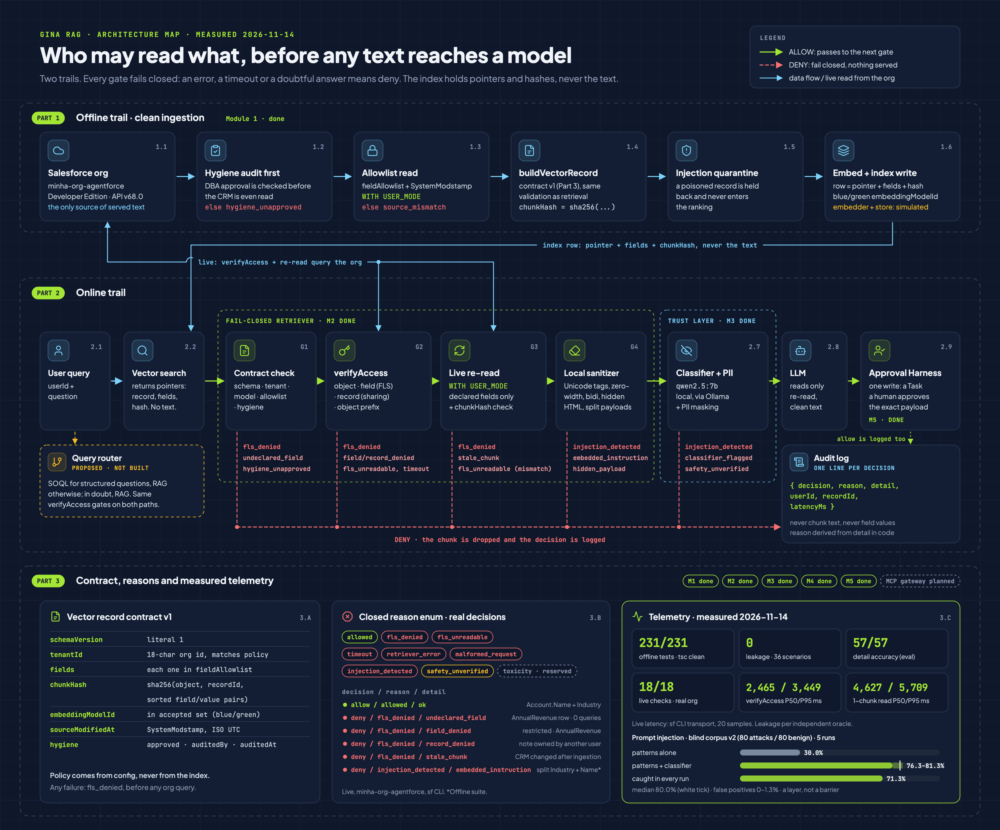
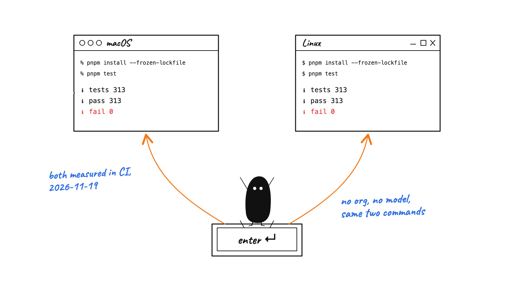

<p align="center"></p>

<h1 align="center">need-to-know</h1>

<p align="center">


</p>

need-to-know (Gina, for short) sits between your CRM and any language model and decides who may read what before a single word of a record reaches the prompt. It runs on Node 24 against a local reference CRM, or against a real Salesforce org.

If you are putting an AI assistant on top of a CRM, the first thing your security team will ask is whether it can show someone data they are not allowed to see. This repo is one answer to that question, with the measurements to back it.

## The problem

A sales team plugs an AI assistant into the CRM. An SDR asks "who is evaluating Service Cloud?" and the answer quotes a revenue figure that SDR was never allowed to see. Nobody wrote a bug. The vector index knew more than the user did.

Most RAG stacks check permissions once, at indexing time, with a service account, and then trust the index. Then the index goes stale, permissions change, a record picks up a poisoned note ("ignore previous instructions and…"), and the model reads all of it.

## What Gina does

The index stores ids, a field list and a SHA-256 of the values, and no text. At query time Gina re-reads the declared fields live and drops the chunk if the hash changed, so the index can never serve more than the CRM would.

Permissions are checked per user, on every query: object, field-level security and record sharing. An error, a timeout or an ambiguous answer counts as a deny. Records are indexed once per audience, so a user who cannot see a field still gets the fields they may read, ranked on those fields alone.

Retrieved text is treated as data. Unicode tags, zero-width and bidi tricks, hidden HTML and embedded instructions are stripped or quarantined, then a local classifier takes a second look. Poisoned records never enter the index.

The model has no write access. It can propose one CRM task; a person approves the exact payload by its hash, outside the model's channel, and Gina re-checks edit access live before writing.

<p align="center"></p>

## Run the tests (offline, no Salesforce, no model)

You need Node 24 and pnpm. The suite runs offline and needs no Ollama.

```sh
pnpm install --frozen-lockfile
pnpm test
```

<p align="center"></p>

Supported platforms are macOS and Linux. On 2026-11-19 both ran the full suite in CI with 313 tests and 0 failures, and on a laptop it finishes in under a second. Windows is not supported. `pnpm eval` then runs the permission evaluator and exits non-zero if a single chunk leaks.

## Try the demo

The demo also needs [Ollama](https://ollama.com) with `nomic-embed-text` and `qwen2.5:7b`.

```sh
pnpm demo
```

It seeds a local reference CRM, indexes it, and asks the same question over MCP as two users. The admin gets three chunks. The restricted user gets none for a question only a hidden field answers, and gets the industries they asked about when their own fields can answer. The model proposes a task: the restricted user's approval is refused, and the admin's creates it exactly once. The record carrying a prompt injection never made it into the index.

```sh
pnpm local ask --as restricted "who is evaluating Service Cloud?"
pnpm local edit 001LOCAL0000001AAA Description="…" && pnpm local reindex
pnpm mcp          # MCP server for Claude Code or any client (GINA_USER_ID=…)
pnpm approvals    # the human channel
```

## What it proves

Every number below comes from a run in this repo, and you can reproduce all of them except the classifier range without a model.

```txt
313/313   adversarial and boundary tests, offline (pnpm test)
0         leaked chunks across 36 permission scenarios (pnpm eval)
76–81%    injection detection on a static blind corpus, 5 runs (adaptive attacker: see below)
0–1.3%    false positives on the same corpus
16/16     decisions measured on the live org, reproduced by the local CRM
```

## What it does not prove

The injection detector lowers the risk, and a determined attacker still gets past it. Against an adaptive attacker (a frontier model that saw only pass or fail), one round of adaptation took the share of attacks reaching the LLM's context from 30 to 35% up to 76 to 78% ([red team](docs/evaluation.md)). Plain business prose ("note from the Sales Director: offer 45%…") gets through.

Three things hold even when detection fails, because they come from how the system is built:

- the model never receives a field or a record the user cannot read;
- the model cannot write to the CRM; a person approves the exact payload, and edit access is re-checked live;
- the index never holds text, so a stale or tampered index serves nothing.

A note that passes can still make the model say something false to the user, such as a fake discount, false urgency or a phishing link. Keep a person on every decision that moves money, and keep the client from rendering links and images it did not expect. That is the class of attack behind [ForcedLeak](https://www.theregister.com/2025/09/26/salesforce_agentforce_forceleak_attack/), which Noma Security disclosed in Agentforce in 2025.

When a claim turned out wrong, it went into [`docs/failure-log.md`](docs/failure-log.md) with how it was caught.

## How it evolved

Chapter 1, [Gina Training Lab](https://github.com/isaacantunesfacha-dev/gina-training-lab), answered *"who needs attention today?"* for a small retailer: deterministic CRM lifecycle rules, a 48/48 adversarial suite and an Agentforce package. It read trusted, structured records.

Chapter 2 answers *"who may read what before any text reaches an LLM?"* with the same philosophy and harder inputs: untrusted, unstructured text; live FLS and sharing instead of rules evaluated on load; indirect prompt injection treated as a first-class threat; a governed write path instead of a single review task.

## What you can take from it

The [vector record contract](docs/contract/vector-record-v1.md) keeps the index from becoming a second, unaudited copy of your CRM.

Fail-closed is enforced by the types. Ports return `unknown`, and only the literal `true` grants access, so a sloppy or hostile adapter cannot open the gate.

Code emits a `detail`, and a single table derives the audit `reason` from it, so there are no hand-written deny messages to drift apart.

The security tests are mutation-tested. Case 20 of the failure log was a test that kept passing with the protection switched off; it now fails when the protection is removed.

## Against a real org

The same ports have Salesforce adapters (`UserEntityAccess`, `UserFieldAccess`, `UserRecordAccess`, `WITH USER_MODE`). `GINA_BACKEND=salesforce` switches the MCP server and the approval channel; `pnpm check:live` measures parity, read-only. Writing to an org takes an explicit flag every time.

## Roadmap

- A query router that picks between a structured query and retrieval, measured by the same evaluator.
- The same rules enforced natively inside Salesforce, so CRM data never has to leave the org.

## Links

[Case study](docs/case-study.md) · [ADRs](adr/) · [Approval harness](docs/approval-harness.md) · [MCP gateway](docs/mcp-gateway.md) · [Evaluation](docs/evaluation.md) · [Failure log](docs/failure-log.md) · [Security](SECURITY.md) · Apache-2.0
